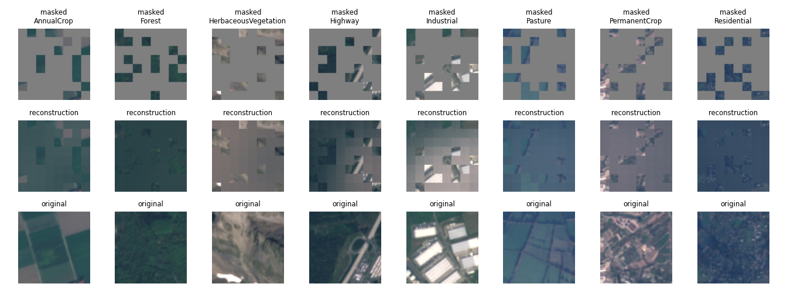
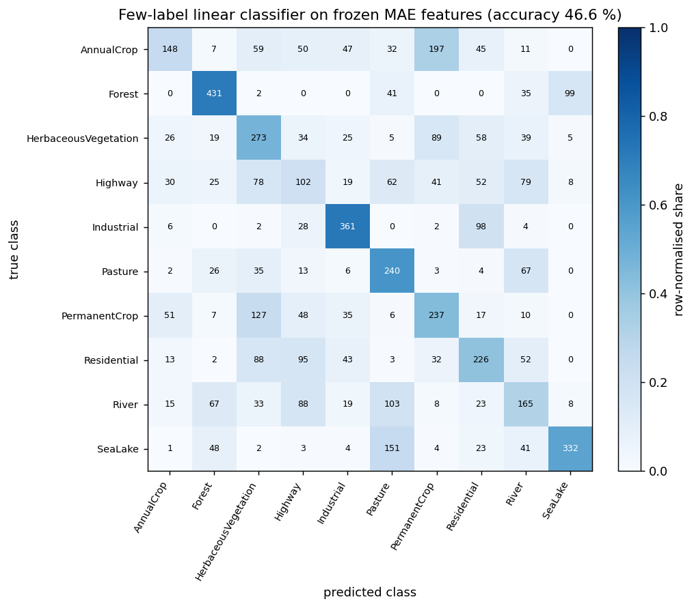
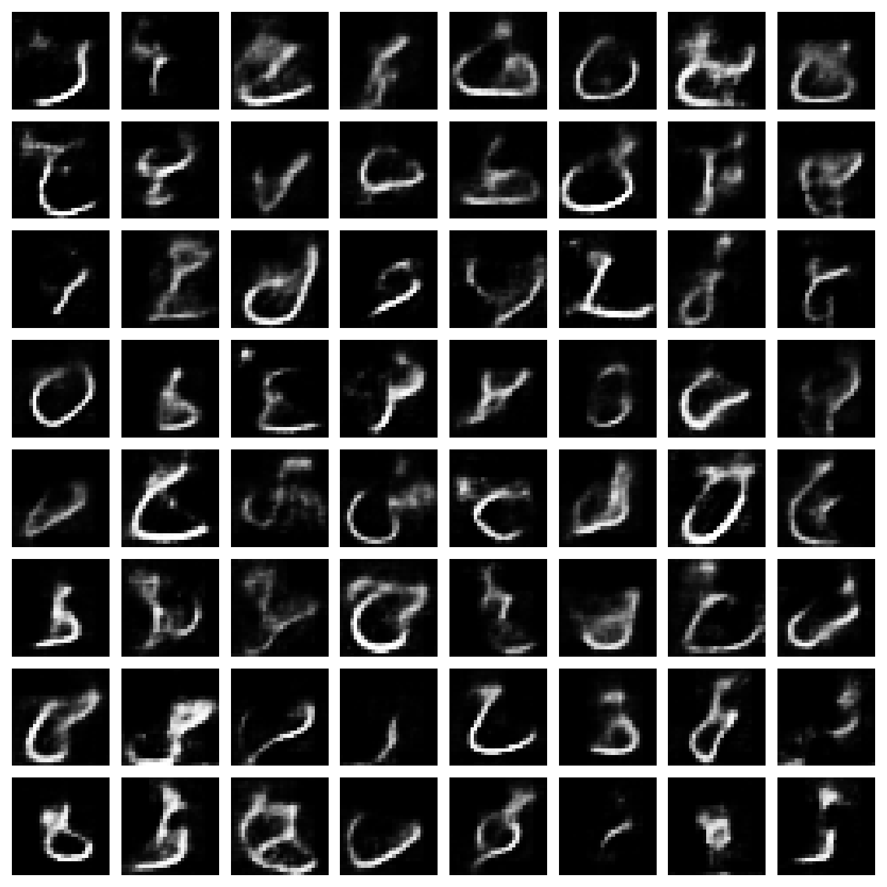
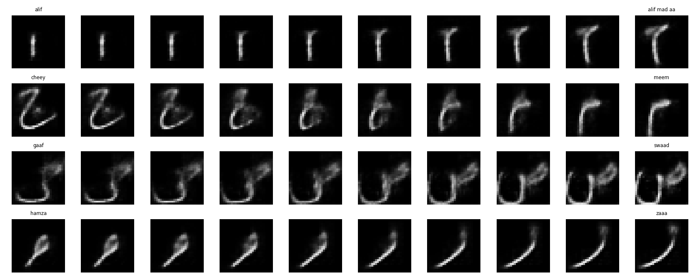
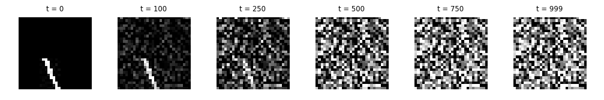
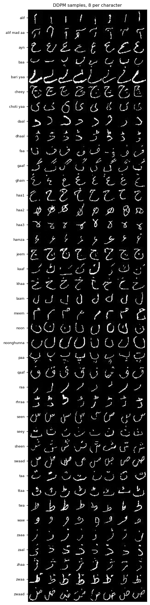
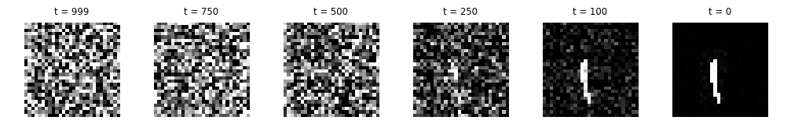
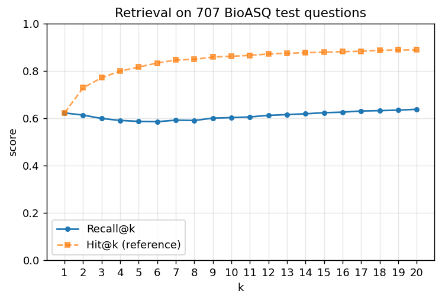

# Four Generative Models, One App: MAE, VAE, Diffusion and RAG

Generative models learn to produce data instead of only labelling it. In this project we built four of them from scratch in PyTorch, each on its own dataset, and put them in a single web app with four tabs. The code is at https://github.com/Hanzala-12/gen-ai-4. We trained everything on a free Kaggle Tesla T4; the whole notebook runs in about 36 minutes.

## Part A: A masked autoencoder on satellite images

**Data:** EuroSAT, 27,000 Sentinel-2 tiles of 64x64 pixels in 10 land-cover classes (16,200 train, 5,400 test).

A masked autoencoder (MAE) hides most of an image and learns to fill it in, without any labels. We cut each tile into 64 patches of 8x8 pixels and keep only 16 random ones. A small transformer encoder (6 layers, width 192) sees just those 16 patches. A shallow decoder (2 layers, width 128) gets the encoded patches plus a learned mask token at every hidden position and predicts the missing pixels. The loss is the squared error on the masked patches only. The model has 3.17 million parameters and trained for 100 epochs in 3.7 minutes. The masked-patch loss ended at 0.0067.

Why mask 75% and not 15% like BERT? Words carry a lot of meaning each, so losing 15% of a sentence is already hard to repair. Neighbouring image patches look almost the same, so with only 15% hidden the model could just smooth over the gaps. Hiding 75% forces it to understand the layout of the scene: where a field edge continues, where a river runs. The reconstructions are blurry, because squared error rewards the average of all plausible fills, but they keep the fields, roads and water.

To test what the encoder learned, we froze it and trained one linear layer on only 160 labelled images (16 per class). It reached **46.6%** accuracy on the 5,400 test tiles, against 10% for guessing. The confusions make sense. Annual crops get mistaken for permanent crops (197 times), herbaceous vegetation for permanent crops, and pasture for river. These classes are defined by land use more than by appearance, and 16 examples are too few for a straight line to separate them.

## Part B: A variational autoencoder on Urdu handwriting

**Data:** UHaT, 28x28 grayscale handwritten Urdu characters, 40 character classes (28,328 train, 4,747 test).

A VAE compresses each character into a 16-number code and decodes it back. The encoder outputs a mean and a log variance, we sample with the reparameterisation trick (z = mu + sigma * eps), and the decoder predicts one logit per pixel. The loss is the negative ELBO: binary cross-entropy for reconstruction plus the closed-form KL divergence to a standard normal.

Over 30 epochs the reconstruction term fell from 201.5 to 104.7 nats and the KL term rose from 14.9 to 25.3. The decoder first learns the average character, then the encoder starts spending KL to tell characters apart. On the test set the negative ELBO is **130.05 nats** (104.77 reconstruction + 25.28 KL).

The KL term is what makes sampling work. Without it the encoder could scatter codes anywhere and shrink the variances, giving sharper reconstructions, but random draws from a standard normal would land in regions the decoder never saw and decode to blobs. We also decode ten equally spaced points between two characters, which morph smoothly from one to the other.

## Part C: Diffusion that writes a requested character

**Data:** the same 40 UHaT classes, scaled to [-1, 1].

A denoising diffusion model (DDPM) learns to remove noise. The forward process adds Gaussian noise in 1,000 steps with a linear schedule (beta from 1e-4 to 0.02). Because everything is Gaussian we can jump straight to any step: x_t = sqrt(alpha_bar_t) x_0 + sqrt(1 - alpha_bar_t) eps. By t = 999, alpha_bar is 4e-5, so the image is pure noise.

We train a U-Net (4.03 million parameters, random initialisation, class label as an extra input) to predict the noise that was added, with the simple loss ||eps - eps_theta(x_t, t, y)||^2. It trained for 40 epochs in 21.5 minutes and ended at a loss of 0.0227. To generate, we start from noise and apply the sampling update 1,000 times. The class label tells the model which character to write.

**VAE or diffusion?** The diffusion samples are clearly sharper. The VAE decodes in one pass through a 16-number bottleneck, and where the code does not fix a detail, the likelihood prefers the average, which is blurry. Diffusion makes 1,000 small steps, each easy to model, and the fine detail appears in the last low-noise steps. The price is speed: one forward pass for the VAE against 1,000 network calls for diffusion.

**Which characters are hardest?** Urdu letters come in families that share a base shape and differ only by dots (be, pe, te, se). At 28x28 pixels a dot is a few pixels, so one missing or misplaced dot turns a letter into its neighbour. These look-alike families are where the model is most likely to be mistaken for another character.

## Part D: Answering biomedical questions with RAG

**Data:** BioASQ (mini): 40,181 PubMed abstracts and 707 test questions, each with 8.66 relevant abstracts on average.

Retrieval-augmented generation looks up evidence before answering. We split each abstract into chunks of at most 150 words with a 30-word overlap, giving 79,332 chunks. Each chunk is embedded with MiniLM (mean pooling over real tokens, then L2 normalisation), so cosine similarity is a dot product. A question is scored against every chunk, an abstract's score is its best chunk, and we return the top abstracts. For generation the top 5 chunks go into a prompt for Qwen2.5-1.5B-Instruct, which must answer only from them, cite passage numbers and say when the passages lack the answer.

| Hit@1 | Hit@5 | Hit@10 | Recall@10 | MRR@10 |
|---|---|---|---|---|
| 0.622 | 0.816 | 0.861 | 0.602 | 0.706 |

On the first 100 questions the answers scored ROUGE-L 0.259, citation precision 0.686 and said "I don't know" 6% of the time. Recall is below Hit because a hit needs one relevant abstract while recall needs all that fit in k, and questions here have almost nine.

Retrieval failed for 98 of 707 questions (13.9%). A general-purpose encoder handles rare drug and protein names poorly: for "What is F105-P?" the top results were about unrelated diseases. For "Is capmatinib effective for glioblastoma?" the retriever found a capmatinib lung-cancer abstract, and the generator wrongly answered "yes". Without a relevant passage the answer cannot be supported, which is why every answer in the app carries the notice "For educational use only. Not medical advice."

## The app

One Gradio app with four tabs: pick a test tile for the MAE, press a button or drag a slider for the VAE, pick a character for diffusion, and ask a question for RAG, which shows the answer, the cited passages with abstract ids and the medical notice. Screenshots are in the README.

## What we learned

Each model fails in a characteristic way: the MAE is blurry, the VAE is soft, diffusion is slow, and RAG is only as good as its retriever. Writing the losses, schedule, pooling and metrics by hand made those trade-offs concrete. Code, results and instructions: https://github.com/Hanzala-12/gen-ai-4
